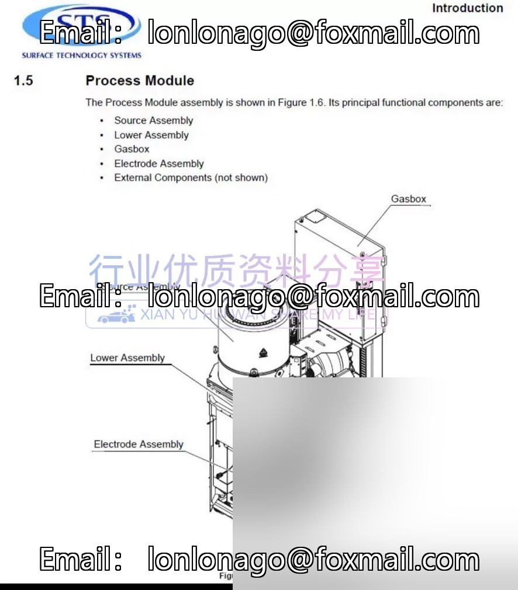
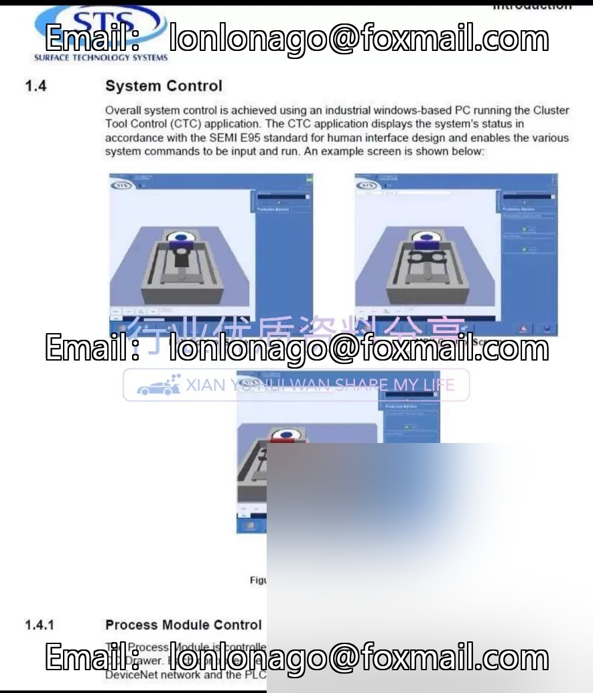
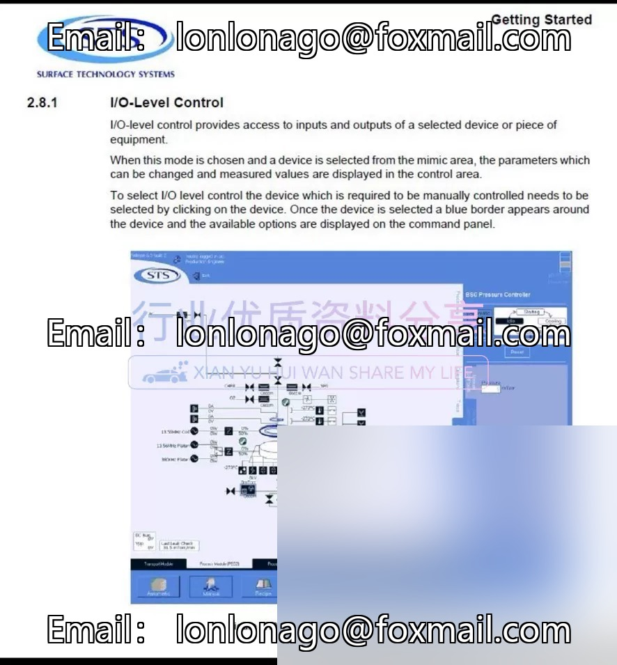

# British STS Company Multiplex LPX etching machine ICP device operation

## Body

The operation manual of ICP equipment for Multiplex LPX etching machine by British STS Company, consisting of over 220 pages with detailed content including equipment structure introduction, operation methods, etc., has great reference value.

Capture and send the electronic original directly! The following images include screenshots of the file portion. Please confirm before placing the order! Due to the replicable nature of electronic documentation Therefore, are allowed after purchase! Thanks for understanding!

The manual covers operations of the UK STS Multiplex LPX ICP equipment, including its structure and methods, with 220+ pages of detailed content and associated screenshots.

<!-- AI_ENRICHED -->

## Images

## Payment

Here is a pay link on Stripe ( https://buy.stripe.com/3cs8yP7sY87d0vu9AB ). Please contact me lonlonago@foxmail.com after funding $89, and I will send you a complete data files , thank you!

